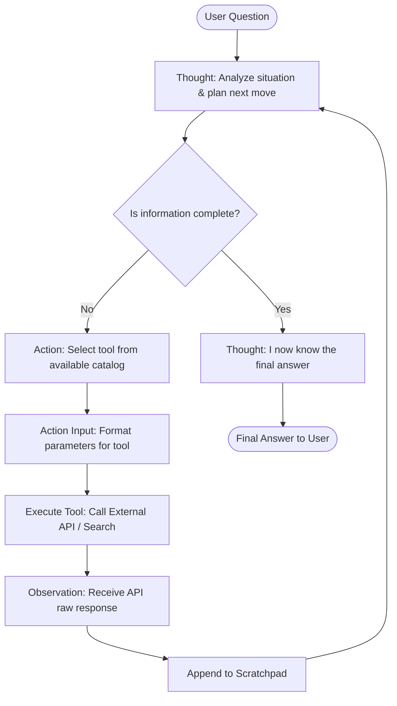

# 🧠 Agentic AI Learning Journey: From Static LLMs to Autonomous ReAct Agents

> **Personal Learning Notes & Technical Deep-Dive**  
> *Author: Yash Sharma ([@Yashh0225](https://github.com/Yashh0225))*  
> *Repository Link:* [weather-ai-agent](https://github.com/Yashh0225/weather-ai-agent)


---

## 📌 Executive Summary

This document captures my learning curve and architectural takeaways while transitioning from **traditional LLM prompting** to building **Agentic AI systems**. 

To ground theory into practice, I engineered an autonomous **AI Weather & Web Search Assistant** using **LangChain**, **Google Gemini Flash**, **Weatherstack API**, **Tavily Search**, and **Streamlit**. Here are the concepts, problems, design decisions, and realizations I documented along the way.

---

## 🧭 Table of Contents

1. [The Problem with "Just an LLM"](#1-the-problem-with-just-an-llm)
2. [Why Agentic AI? The Paradigm Shift](#2-why-agentic-ai-the-paradigm-shift)
3. [Core Foundations of Agentic AI](#3-core-foundations-of-agentic-ai)
4. [The ReAct (Reasoning + Acting) Framework](#4-the-react-reasoning--acting-framework)
5. [LangChain Concepts Deconstructed in this Project](#5-langchain-concepts-deconstructed-in-this-project)
6. [Architecture & Workflow of the Weather Agent](#6-architecture--workflow-of-the-weather-agent)
7. [What This Project Taught Me (Hard-Won Lessons)](#7-what-this-project-taught-me-hard-won-lessons)
8. [Why I Built This & My Agentic AI Roadmap](#8-why-i-built-this--my-agentic-ai-roadmap)

---

## 1. The Problem with "Just an LLM"

When people first interact with Large Language Models (LLMs) like GPT-4 or Gemini, they feel like magic. However, when attempting to build production software with isolated LLMs, several hard boundaries immediately emerge:

```
+------------------------------------------------------------------------+
|                      Limitations of Raw LLMs                           |
+------------------------------------+-----------------------------------+
| ❌ Knowledge Cutoff                 | Cannot know live weather, news,   |
|                                    | stock prices, or private databases|
+------------------------------------+-----------------------------------+
| ❌ Hallucination Risk              | Confidently generates false facts |
|                                    | when missing verified information |
+------------------------------------+-----------------------------------+
| ❌ No Environmental Agency         | Cannot call APIs, query DBs, write|
|    ("A brain without hands")       | files, or trigger real-world actions|
+------------------------------------+-----------------------------------+
| ❌ Single-Pass / Passive           | Generates output token-by-token in|
|                                    | one shot without verifying step 1 |
+------------------------------------+-----------------------------------+
| ❌ Poor at Multi-Step Composition  | Complex problems needing sequential|
|                                    | lookups fail or lose coherence    |
+------------------------------------+-----------------------------------+
```

### Concrete Example:
If you ask a raw, disconnected LLM:
> *"What is the current weather in the capital of India?"*

An isolated LLM either:
1. Says *"I don't have access to real-time information."*
2. Hallucinates a temperature based on training probabilities (e.g., *"It's sunny and 28°C"*).

To solve this, we cannot just prompt harder; **the model needs agency.**

---

## 2. Why Agentic AI? The Paradigm Shift

**Agentic AI** represents a structural shift from **Passive Generation** to **Autonomous Goal Execution**.

| Dimension | Traditional LLM / Prompt Engineering | Agentic AI System |
| :--- | :--- | :--- |
| **Control Flow** | Linear: Input $\rightarrow$ Prompt $\rightarrow$ Output | Dynamic Loop: Plan $\rightarrow$ Act $\rightarrow$ Observe $\rightarrow$ Iterate |
| **Data Access** | Static weights + context window | Dynamic, live tool invocation (APIs, search, DBs) |
| **Verification** | Blind generation | Observation-driven validation before final answer |
| **Error Recovery** | Fails silently or gives wrong answer | Can read error message from tool and retry |
| **Role of LLM** | The entire system (answering engine) | The cognitive core / orchestrator (reasoning engine) |

In an agentic architecture, **the LLM is no longer the knowledge base; it is the reasoning engine** that decides *what* to do, *which* tool to use, *when* to stop, and *how* to synthesize real-time observations into a factual answer.

---

## 3. Core Foundations of Agentic AI

An AI Agent consists of four foundational pillars:

```
                      +-------------------+
                      |      GOAL /       |
                      |   USER QUESTION   |
                      +---------+---------+
                                |
                                v
+---------------------------------------------------------------+
|                        AI AGENT                               |
|                                                               |
|  +--------------------+             +----------------------+  |
|  |     PERCEPTION     |             |      PLANNING        |  |
|  | Parses goal, context|             | Deconstructs tasks   |  |
|  +---------+----------+             +----------+-----------+  |
|            |                                   |              |
|            +-----------------+-----------------+              |
|                              v                                |
|                   +---------------------+                     |
|                   |  REASONING ENGINE   |                     |
|                   |   (LLM: Gemini)     |                     |
|                   +----------+----------+                     |
|                              |                                |
|            +-----------------+-----------------+              |
|            v                                   v              |
|  +--------------------+             +----------------------+  |
|  |       ACTION       |             |   MEMORY/SCRATCHPAD  |  |
|  | Dispatches to tool |             | Tracks history &     |  |
|  +---------+----------+             | past observations    |  |
|            |                        +----------------------+  |
+------------|--------------------------------------------------+
             v
+------------------------+
|    ENVIRONMENT / TOOLS |
| (Weather API, Tavily)  |
+------------------------+
```

1. **Perception**: Receiving user inputs, understanding intent, and accessing environment state.
2. **Brain (Reasoning Core)**: Evaluates the current state against the end goal and formulates hypotheses.
3. **Actuators (Tools)**: Functions exposed to the agent (REST APIs, search engines, calculators, databases).
4. **Memory & Scratchpad**: Short-term execution trace (Thought $\rightarrow$ Action $\rightarrow$ Observation) and long-term conversational memory.

---

## 4. The ReAct (Reasoning + Acting) Framework

This project implements the seminal **ReAct** architecture introduced by Yao et al. (2022). 

ReAct combines **Chain-of-Thought (CoT) reasoning** with **action execution**:
- Reasoning alone without action leads to hallucinations.
- Action alone without reasoning leads to brute-force trial and error.
- **ReAct tightly intertwines both in an iterative loop:**



### The Exact ReAct Prompt Contract

The ReAct pattern works by enforcing a strict cognitive protocol inside the prompt:

```text
Question: the user's question
Thought: explain what you need to do.
Action: one of [{tool_names}]
Action Input: the input for the selected tool
Observation: the result returned by the tool.
... (this cycle repeats)
Thought: I now know the final answer.
Final Answer: your final response.
```

---

## 5. LangChain Concepts Deconstructed in this Project

Building this agent demystified key LangChain modules that are often treated as black boxes:

### 1. `ChatGoogleGenerativeAI` (Model Provider)
- Utilized Google's `gemini-3.8-flash` with `temperature=0`.
- **Key Learning**: For agentic workflows, deterministic temperature ($0$) is vital. Higher temperatures introduce variation in tool names and formatting syntax, resulting in parsing errors.

### 2. `@tool` Decorator (Tool Interface Schema)
- The `@tool` decorator in LangChain converts regular Python functions into structured tool schemas that the LLM understands:
```python
@tool
def get_weather_data(city: str) -> str:
    """
    Fetch current weather information for a city.
    """
    # function logic ...
```
- **Key Learning**: The **type annotations** (`city: str`) and the **docstring** (`"""Fetch current weather..."""`) are not just developer documentation—they are compiled directly into the system prompt! If the docstring is vague, the agent will invoke the wrong tool or pass invalid arguments.

### 3. `PromptTemplate` & Agent Scratchpad
- The `{agent_scratchpad}` variable is where LangChain injects previous iteration steps (the history of thoughts, actions, and observations).
- Without the scratchpad, the LLM would suffer from amnesia after every tool call and loop infinitely.

### 4. `create_react_agent` (Graph / Logic Compiler)
- Binds the LLM, the tool definitions, and the prompt contract into a unified runnable pipeline that knows how to parse text outputs into structured agent decisions.

### 5. `AgentExecutor` (The Runtime Engine)
- While `agent` decides what to do, `AgentExecutor` is the runtime execution harness that:
  - Executes the actual Python functions when an `Action` is requested.
  - Feeds the tool output back as `Observation`.
  - Enforces `max_iterations=5` to prevent infinite runaway loops and API quota exhaustion.
  - Handles parsing errors gracefully (`handle_parsing_errors=True`).

### 6. Streamlit Session State & Resource Caching
- Used `st.session_state` to maintain chat message history across Streamlit reruns.
- Used `@st.cache_resource` on `create_agent()` so the agent executor and LLM connection are initialized once, rather than re-instantiated on every user keystroke.

---

## 6. Architecture & Workflow of the Weather Agent

Here is how the components in [app.py](file:///c:/Users/sanja/Desktop/langchain-agent/app.py) and [main.py](file:///c:/Users/sanja/Desktop/langchain-agent/main.py) interconnect:

```
+-----------------------------------------------------------------------------------------+
|                                    USER INTERFACE                                       |
|                  Streamlit Web Chat (app.py)  /  Terminal CLI (main.py)                 |
+--------------------------------------------+--------------------------------------------+
                                             | User Prompt
                                             v
+-----------------------------------------------------------------------------------------+
|                                  AGENT EXECUTOR RUNTIME                                 |
|                                                                                         |
|   +---------------------------------------------------------------------------------+   |
|   |                           REASONING CYCLE (ReAct)                               |   |
|   |                                                                                 |   |
|   |   PromptTemplate  --->  Gemini 3.8 Flash (LLM)  --->  Output Parser             |   |
|   |        ^                                                      |                 |   |
|   |        |                                                      v                 |   |
|   |        |                                            [Action or Final Answer?]   |   |
|   |        |                                           /                        \   |   |
|   |        |               Action: Tool Selected     /                            \ |   |
|   |        |                                        v                              v|   |
|   |        |                          +------------------------+      +-----------+ |   |
|   |        |                          | Tool Execution Engine  |      |   Final   | |   |
|   |        |                          +-----------+------------+      |  Answer   | |   |
|   |        |                                      |                   +-----+-----+ |   |
|   |        +--- Appends to {agent_scratchpad} <---+                         |       |   |
|   |                 (Observation result)                                    |       |   |
|   +-------------------------------------------------------------------------|-------+   |
+-----------------------------------------------------------------------------|-----------+
                                                                              |
                                     +----------------------------------------+
                                     |
                                     v
                       +---------------------------+
                       |    Render in Chat UI /    |
                       |    Print to Terminal      |
                       +---------------------------+

            +-------------------------------------------------------+
            |                  EXTERNAL TOOLS CATALOG               |
            |                                                       |
            |  [1] TavilySearchResults   --> Live Web Search Engine |
            |  [2] get_weather_data      --> Weatherstack REST API  |
            +-------------------------------------------------------+
```

### Trace Walkthrough: Multi-Hop Reasoning in Action

When a user submits:
> *"Find the capital of India and find its current weather."*

Here is the exact multi-step execution trace executed by the agent:

```text
> Entering new AgentExecutor chain...

Thought: The user is asking for the capital of India and its current weather.
First, I need to know the capital of India. Then, I can find the weather for that capital.
Action: tavily_search_results_json
Action Input: capital of India

Observation: [{'url': '...', 'content': 'New Delhi is the capital of India...'}]

Thought: The capital of India is New Delhi. Now I need to find the current weather in New Delhi.
Action: get_weather_data
Action Input: New Delhi

Observation: Weather in New Delhi: 24°C, Sunny. Humidity: 42%.

Thought: I now have the capital of India and its current weather.
Final Answer: The capital of India is New Delhi. The current weather in New Delhi is 24°C, Sunny with a humidity of 42%.

> Finished chain.
```

Notice how the agent autonomously:
1. Decomposed a compound prompt into sub-goals.
2. Formulated a web search for the factual question (capital of India).
3. Extracted the entity (`New Delhi`) from the search observation.
4. Selected the specialized weather tool with the extracted entity as input.
5. Combined both observations into a cohesive, grounded response.

---

## 7. What This Project Taught Me (Hard-Won Lessons)

### Lesson 1: ReAct Parsing is Sensitive
- LLMs naturally want to talk conversationally or output Markdown blocks (` ```json ... ````).
- If the model deviates by a single character (e.g. writing `Action:` and `Action Input:` on the same line), the parser fails with an `OutputParserException`.
- **Solution**: Explicit strict rules in the prompt + configuring `handle_parsing_errors=True` in `AgentExecutor` ensures resilience.

### Lesson 2: Write Fail-Safe Tool Responses
- In early testing, if an API call timed out or received a 404, throwing an unhandled Python exception crashed the entire application.
- **Solution**: Catch errors inside the tool function and return a friendly error string (e.g. `"Could not fetch weather data: City not found"`). The LLM can read this as an **Observation** and decide to re-attempt with a different spelling or notify the user gracefully.

### Lesson 3: Tool Descriptions are Prompts
- How you name your function and what you write in your docstring directly affects whether the LLM calls it.
- Tool naming must be semantic, explicit, and concise.

### Lesson 4: Guardrails Prevent Cost Runaways
- Agents operating in a loop can get stuck in infinite thought cycles if a tool returns unexpected output.
- Setting `max_iterations=5` ensures the agent stops and explains itself rather than draining API credits.

### Lesson 5: Certificate & Network Handling in Python
- On Windows systems, SSL handshakes with external APIs can fail in virtual environments.
- Injecting `certifi.where()` into `SSL_CERT_FILE` resolved SSL verification errors across all outbound requests.

---

## 8. Why I Built This & My Agentic AI Roadmap

### Why I Built This Project
I wanted to move beyond tutorials and passive prompting to understand **how autonomous AI systems actually think and act**. Building this hands-on project allowed me to experience the engineering challenges of:
- Interfacing LLMs with external REST endpoints.
- Orchestrating multi-hop cognitive loops.
- Bridging backend reasoning with a responsive frontend.

### Next Steps on My Agentic AI Roadmap
- [ ] **LangGraph State Machines**: Transitioning from linear `AgentExecutor` to cyclical graphs with checkpoints, branching, and state schemas.
- [ ] **Multi-Agent Collaboration**: Creating specialized sub-agents (e.g., Researcher Agent $\leftrightarrow$ Critic/Verifier Agent).
- [ ] **Memory Systems**: Implementing vector store-backed long-term memory (ChromaDB / Pinecone) for personalized recall across sessions.
- [ ] **Human-in-the-Loop (HITL)**: Adding interactive breakpoints where the agent asks for confirmation before executing impactful actions.
- [ ] **Evaluation with LangSmith**: Tracing token counts, latency bottlenecks, and agent trajectory evaluations.

---

*“The future of AI is not just about better models; it's about giving models the tools, reasoning loops, and agency to solve real-world problems.”*
