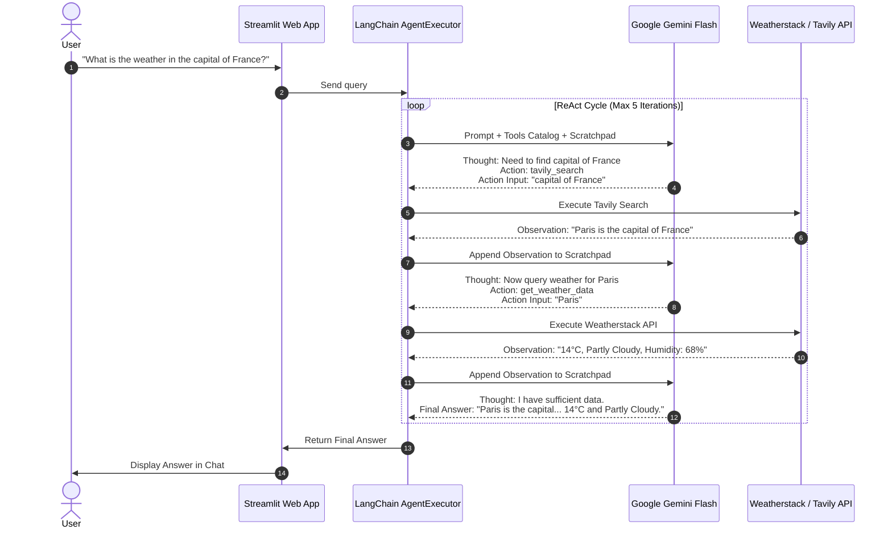

# 🤖 Autonomous AI Weather & Web Search Agent

[](https://www.python.org/)
[](https://www.langchain.com/)
[](https://ai.google.dev/)
[](https://streamlit.io/)
[](https://opensource.org/licenses/MIT)

> An intelligent, autonomous **ReAct (Reasoning + Acting)** agent built from scratch using **LangChain**, **Google Gemini Flash**, **Weatherstack API**, and **Tavily Search**. The agent dynamically decomposes complex user queries, plans multi-hop steps, queries live external APIs, and synthesizes grounded answers in an interactive **Streamlit** interface.

---

### 📖 Looking for the Theory & Learning Breakdown?
> 👉 **[Click here to read LEARNINGS.md](file:///c:/Users/sanja/Desktop/langchain-agent/LEARNINGS.md)** — A detailed breakdown of:
> - **The Problem with Just LLMs** (knowledge cutoffs, hallucinations, passive text generation)
> - **Why Agentic AI?** (the paradigm shift from chatbots to autonomous loops)
> - **ReAct Framework deep-dive** (Thought $\rightarrow$ Action $\rightarrow$ Observation)
> - **LangChain Core Concepts** (`@tool`, `AgentExecutor`, `PromptTemplate`, scratchpad memory)
> - **Engineering lessons learned & future roadmap**

---

## 🌟 Overview & Key Features

Traditional LLMs are passive: they rely solely on static training weights and cannot check live external information. 

This project bridges that gap by implementing an **Agentic AI architecture** where the LLM serves as the cognitive orchestrator:

- 🔍 **Real-Time Web Search**: Integrates **Tavily Search API** to fetch up-to-date facts, current events, and web information.
- ⛅ **Live Weather Integration**: Custom tool querying the **Weatherstack REST API** for real-time temperature, condition descriptions, and humidity.
- 🧠 **Autonomous Multi-Hop Reasoning**: Capable of chaining actions where Step 2 depends on Step 1 (e.g., *"Find the capital of India and check its weather"* $\rightarrow$ Searches capital $\rightarrow$ Discovers *"New Delhi"* $\rightarrow$ Queries weather for *"New Delhi"*).
- 💬 **Interactive Chat Interface**: Beautiful, responsive **Streamlit** web application with persistent session state and real-time execution feedback.
- ⚡ **Dual Execution Modes**: Run headlessly in terminal via [main.py](file:///c:/Users/sanja/Desktop/langchain-agent/main.py) or as a rich web application via [app.py](file:///c:/Users/sanja/Desktop/langchain-agent/app.py).
- 🛡️ **Defensive Engineering**: Built-in parsing error handlers, `max_iterations=5` guardrails against infinite loops, and API error safety nets.

---

## 🏗️ Architecture & How It Works

The agent uses the **ReAct (Reasoning + Acting)** cognitive loop:



---

## ⚡ Execution Trace Example

When given a multi-part prompt, here is how the agent's internal thought loop executes in real-time:

```text
User Question: "Find the capital of India and find its current weather."

[1] Thought: The user wants to know the capital of India and its current weather.
    Action: tavily_search_results_json
    Action Input: capital of India
    Observation: [{'url': '...', 'content': 'New Delhi is the capital of India...'}]

[2] Thought: The capital of India is New Delhi. Now I need to find the weather for New Delhi.
    Action: get_weather_data
    Action Input: New Delhi
    Observation: Weather in New Delhi: 24°C, Sunny. Humidity: 42%.

[3] Thought: I now know the final answer.
    Final Answer: The capital of India is New Delhi. The current weather there is 24°C, Sunny, with a humidity of 42%.
```

---

## 📂 Project Structure

```text
langchain-agent/
│
├── app.py               # Streamlit web application with chat UI & state management
├── main.py              # CLI entry point for headless agent execution & testing
├── requirements.txt     # Python dependencies
├── .env.example         # Template for environment variables (API keys)
├── .gitignore           # Protects secrets & excludes virtualenv from git
├── LEARNINGS.md         # In-depth technical guide on Agentic AI & concepts learned
├── README.md            # Project documentation & quickstart guide
│
└── research/            # Experimental exploration & Jupyter notebook prototypes
    └── agent_demo.ipynb # Early notebook exploration of LangChain ReAct loops
```

---

## 🚀 Getting Started

### 1. Prerequisites
- Python 3.10 or 3.11 installed
- Conda (optional, but recommended)

### 2. Clone the Repository
```bash
git clone https://github.com/Yashh0225/weather-ai-agent.git
cd weather-ai-agent
```

### 3. Create & Activate Virtual Environment

**Using Conda:**
```bash
conda create -n langagent python=3.11 -y
conda activate langagent
```

**Or using Python venv:**
```bash
python -m venv .venv
# On Windows:
.venv\Scripts\activate
# On Linux/macOS:
source .venv/bin/activate
```

### 4. Install Dependencies
```bash
pip install -r requirements.txt
```

### 5. Configure API Keys
Create a `.env` file in the root directory:

```env
GOOGLE_API_KEY="your_google_gemini_api_key_here"
TAVILY_API_KEY="your_tavily_search_api_key_here"
WEATHERSTACK_API_KEY="your_weatherstack_api_key_here"
```

| Key | Where to get it | Free Tier Available? |
| :--- | :--- | :--- |
| `GOOGLE_API_KEY` | [Google AI Studio](https://aistudio.google.com/) | ✅ Yes |
| `TAVILY_API_KEY` | [Tavily AI](https://tavily.com/) | ✅ Yes (1,000 queries/mo) |
| `WEATHERSTACK_API_KEY` | [Weatherstack API](https://weatherstack.com/) | ✅ Yes |

---

## 💻 How to Run

### Option A: Interactive Web UI (Streamlit)
Launch the interactive web assistant:
```bash
streamlit run app.py
```
Open your browser at `http://localhost:8501`.

### Option B: Terminal CLI
Run a direct query test via command line:
```bash
python main.py
```

---

## 🛠️ Tech Stack & Tools

- **Core Reasoning Engine**: [Google Gemini Flash](https://ai.google.dev/) (`gemini-3.8-flash`) via `langchain-google-genai`
- **Agent Orchestration**: [LangChain](https://www.langchain.com/) (`create_react_agent`, `AgentExecutor`, `PromptTemplate`)
- **Live Search**: [Tavily Search API](https://tavily.com/) (`TavilySearchResults`)
- **Weather API**: [Weatherstack](https://weatherstack.com/) REST API via `requests`
- **Frontend / UI**: [Streamlit](https://streamlit.io/)
- **Configuration & Security**: `python-dotenv`, `certifi`

---

## 📚 What I Learned (Summary)

Building this project provided firsthand insight into key engineering patterns:
1. **Prompt Contract Enforceability**: Why strict ReAct formatting instructions prevent the LLM from hallucinating Markdown formatting or premature JSON.
2. **Tools as Semantic Interfaces**: How Python docstrings and type hints directly serve as the prompt instructions for tool selection.
3. **Robust Error Handling**: Catching tool exceptions gracefully so the agent receives informative feedback rather than crashing the runtime.
4. **Agentic vs. Traditional LLMs**: Experiencing how an iterative execution loop solves complex, multi-hop real-world questions that static LLMs fail at.

👉 **Read the full engineering deep-dive in [LEARNINGS.md](file:///c:/Users/sanja/Desktop/langchain-agent/LEARNINGS.md).**

---

## 🗺️ Roadmap & Next Goals

- [ ] Upgrade agent flow to **LangGraph** for cyclic multi-agent graph workflows.
- [ ] Add conversation memory with vector databases (ChromaDB / Pinecone).
- [ ] Add Human-in-the-Loop (HITL) approval step for external actions.
- [ ] Integrate telemetry and trace evaluation with **LangSmith**.

---

## 🤝 Connect

If you're also exploring Agentic AI, LangChain, or LLM system architectures, feel free to connect or star this repo!

- **Author**: Yash Sharma ([@Yashh0225](https://github.com/Yashh0225))
- **GitHub**: [github.com/Yashh0225](https://github.com/Yashh0225)
- **Focus**: Building Autonomous AI Agents, Multi-Agent Systems & Applied GenAI Pipelines
